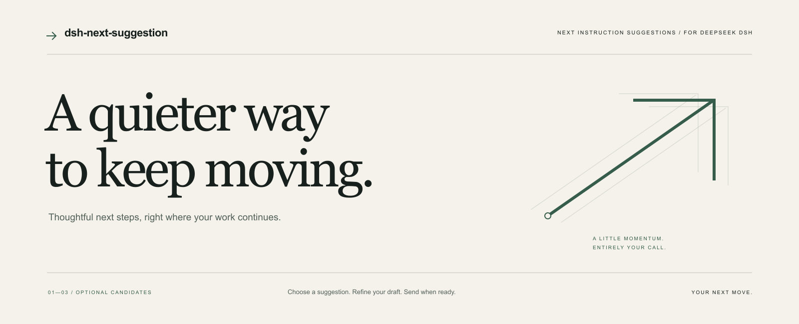
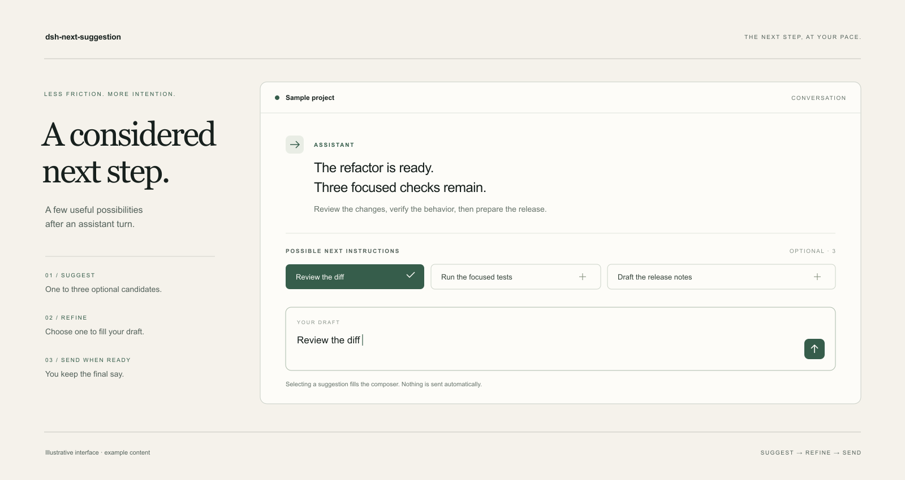

<p align="right"><a href="README.md">English</a> · <strong>简体中文</strong></p>



<p align="center">
<a href="https://github.com/Jul11us/dsh-next-suggestion/releases/latest">下载插件</a> ·
<a href="#开始使用">开始使用</a> ·
<a href="docs/ARCHITECTURE.md">实现方式</a> ·
<a href="LICENSE">MIT 开源协议</a>
</p>

# 下一步，自然发生。

**让思路延续，让决定留在你手中。**

为 **DeepSeek DSH** 打造的轻量指令建议插件。助手完成一轮回答后，在输入框上方给出至多三条具体的下一步指令。选中、斟酌，再由你发送。

建议只是一个起点。**点击只填入草稿，始终由你决定何时发送。**

---

### 恰到好处的提示，清晰可控的边界。

| 一点帮助 | 一份克制 |
| :--- | :--- |
| **接住当前思路** | 结合近期对话与未完成待办，给出简短、具体的后续指令。 |
| **把表达交还给你** | 点击填入输入框并恢复焦点，保留发送前的修改空间。 |
| **安静地出现与退场** | 输入、打开命令菜单、切换会话，或在输入框按 Esc 时收起；1.5 秒内没有结果就不显示。 |
| **偏好轻量模型** | 自动模式优先选择名称含 `flash`、`mini`、`lite` 等的模型。这是名称启发式，并非实时比价。 |
| **只取有限上下文** | 将有限文本交给 DSH 中配置的提供方，并尝试清洗常见密钥模式与路径用户名。 |



<p align="center"><sub>界面示意图，使用虚构示例内容；实际外观随 DSH 主题变化。</sub></p>

### 三步，继续你的工作。

1. **完成一轮对话。** 助手回答结束后，保持输入框为空。
2. **选一个方向。** 点击建议，或用 `×` 隐藏不需要的候选。
3. **写成你的表达。** 检查草稿、自由修改，再亲自发送。

至少出现两轮用户消息后才会预测。上下文不足或只有寒暄时，可能不显示建议。隐藏记录保存在页面内存中，每个会话最多二十条，最多跟踪五十个浏览器会话。

## 开始使用

**运行要求：** Node.js **22.19 或更高版本**、DeepSeek DSH **`>=0.2.1-rc.2 <0.3.0`**、Web GUI 或 Desktop 客户端，以及已配置的模型提供方。原始开发基线为 DSH `0.2.1-rc.2`，尚未逐一验证范围内的所有版本。

### 安装发布包

1. 下载 [`dsh-next-suggestion-0.1.0.tgz`](https://github.com/Jul11us/dsh-next-suggestion/releases/download/v0.1.0/dsh-next-suggestion-0.1.0.tgz)，或复制其下载链接。
2. 在 DSH 中打开 **插件 → 添加插件 / 安装第三方插件**，将 `.tgz` 下载链接填入包名字段。
3. 启用 **下一条指令预测**，重启 DSH，再刷新客户端。

如果当前安装器不支持压缩包链接，可解压下载文件，将其中的 `package` 目录作为本地插件安装。

### 从源码安装

```sh
git clone https://github.com/Jul11us/dsh-next-suggestion.git
cd dsh-next-suggestion
npm ci --ignore-scripts
```

通过 DSH 本地插件入口选择克隆后的目录，启用 bundle，重启 DSH 并刷新客户端。桌面 profile 也可以使用：

```text
dsh plugin --profile desktop add "file:C:\path\to\dsh-next-suggestion"
```

本版本通过 GitHub Release 分发；以上安装方式均不依赖 npm registry 上架。

## 调成你习惯的样子

打开 **插件 → 下一条指令预测 → Configure**，或 **设置 → 下一条指令**。

| 设置 | 默认值 | 作用 |
| :--- | :--- | :--- |
| 启用预测 | 开启 | 关闭后停止发起新的预测调用。 |
| 候选条数 | `3` | 显示一至三条建议。 |
| 提供方 / 模型 | 留空 | 自动选择，或指定偏好的提供方与模型。 |
| 宿主超时 | `8000 ms` | 限制宿主请求时长；界面仍使用独立的 1.5 秒展示窗口。 |
| 调试信息 | 关闭 | 在建议条显示 token 数、耗时和调用次数。 |

自动路由偏好名称看起来较轻量的模型；回退到推理型或看起来昂贵的模型时，每个被跟踪的会话最多预测一次。只填提供方时限定在该提供方内选择，只填模型时匹配该模型；两者同时指定则覆盖自动选择。预测会产生提供方的模型调用费用。

## 有限的上下文，明确的数据去向

插件可能向你配置的提供方发送：当前会话标题、最多六条未完成待办，以及最近最多六轮 user/assistant 文本。助手文本会截短，围栏代码块替换为 `[code]`。用户消息仍可能包含粘贴的代码或敏感内容。

发送前会尝试清洗常见 API key / token 模式、Bearer 字符串、长 base64 内容，以及常见用户主目录路径中的用户名。**清洗无法覆盖所有密钥与个人信息。** 请结合所选提供方和会话内容使用。

插件不会另行读取文件全文、附件正文或工具输出正文来构建提示词，不添加分析上报端点，也不将预测上下文写入磁盘。内存状态分别随页面刷新或宿主重启清除；DSH 与模型提供方本身的存储行为由各自决定。

## 小而清晰，也便于理解。

两个 JavaScript 模块，使用公开的 DSH 扩展点，无须构建。宿主负责跟踪回合与模型调用，客户端负责呈现建议和填入草稿，无须修改 DSH 内核。

- [架构与扩展点](docs/ARCHITECTURE.md)
- [维护者发布指南](PUBLISHING.md)
- [宿主测试](https://github.com/Jul11us/dsh-next-suggestion/blob/main/test/host.test.mjs) · [客户端测试](https://github.com/Jul11us/dsh-next-suggestion/blob/main/test/client.test.mjs)

```sh
npm ci --ignore-scripts
npm test
npm pack --dry-run
```

测试通过替身覆盖宿主行为与客户端交互，不能替代所有 DSH 版本、真实模型或安装路径的验证。慢响应、未正常结束的回合、上下文不足或设置服务不可用，都可能使建议条保持为空。

---

面向 DeepSeek DSH 的独立社区插件。以 [MIT 协议](LICENSE) 开源。
